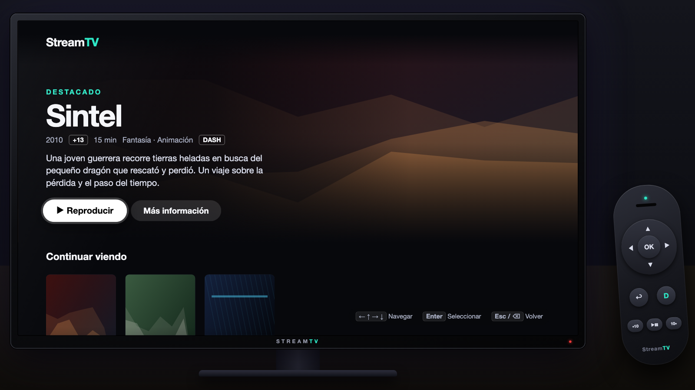
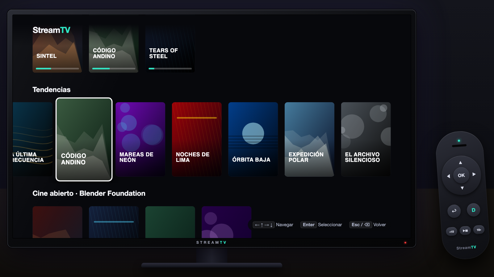
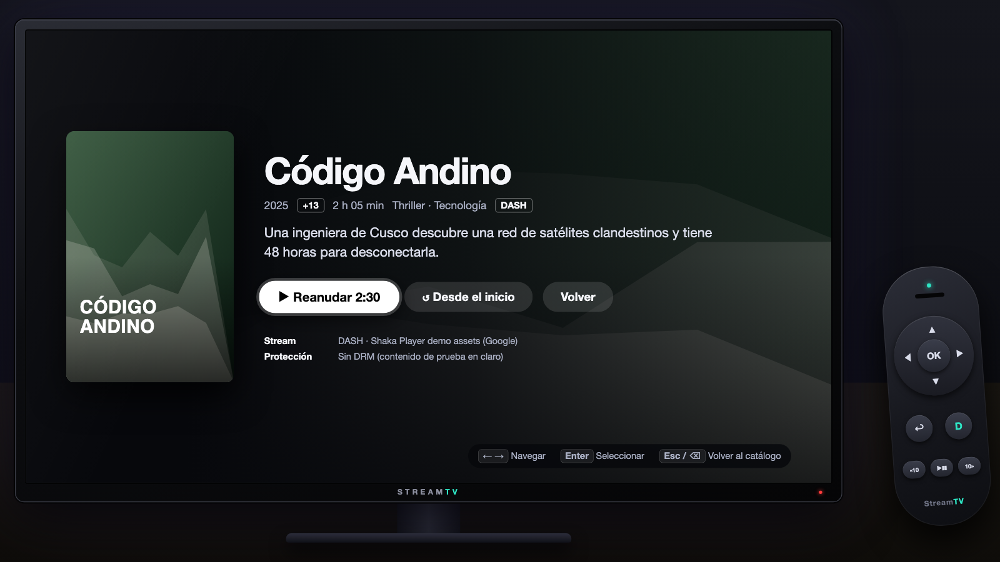
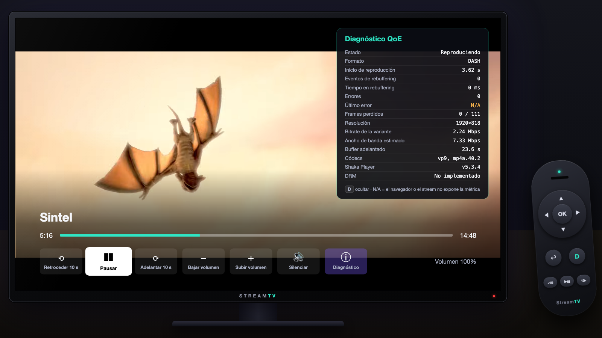
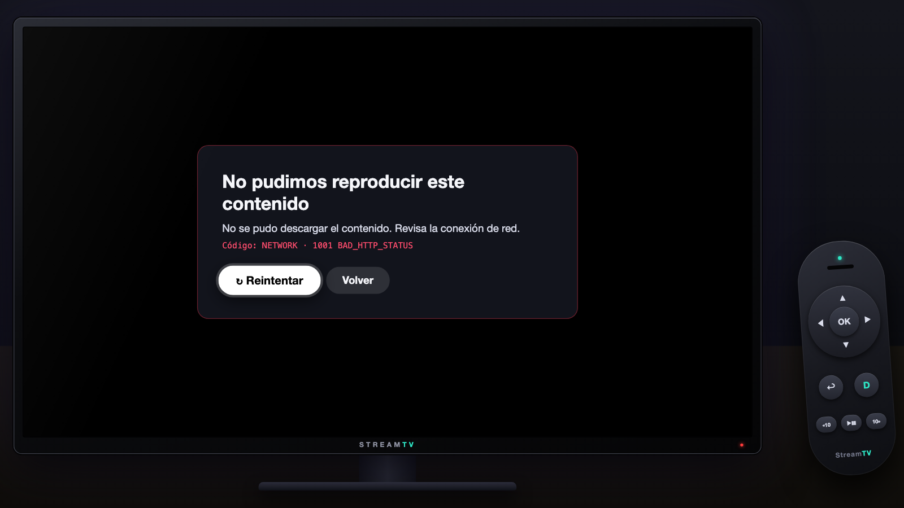

# StreamTV · React OTT para Smart TV

MVP de una aplicación de streaming pensada para **control remoto (D-pad)**, que se ejecuta en Chrome como simulación de Smart TV. Prioriza ingeniería, reproducción real y calidad sobre cantidad de funcionalidades.



| Catálogo con foco | Detalle | Reproductor + QoE (tecla D) | Error y reintento |
| --- | --- | --- | --- |
|  |  |  |  |

- **React 19 + TypeScript + Vite** · CSS convencional, sin librerías visuales
- **Shaka Player 5** para MPEG-DASH y HLS, cargado bajo demanda
- **Vitest + Testing Library** (62 tests) · **Playwright** (7 E2E con reproducción real)
- Catálogo mock local, sin backend, sin autenticación, sin DRM

---

## Instalación y ejecución

Requisitos: Node 20.19+ o 22.12+ (probado con Node 24) y conexión a internet (los streams son públicos).

```bash
npm install
npx playwright install chromium   # solo para los E2E

npm run dev          # http://localhost:5173
```

| Script | Qué hace |
| --- | --- |
| `npm run dev` | Servidor de desarrollo |
| `npm run build` | Typecheck + build de producción en `dist/` |
| `npm run preview` | Sirve el build de producción |
| `npm run test` | Pruebas unitarias e integración (Vitest) |
| `npm run test:e2e` | Pruebas E2E (Playwright, levanta el build automáticamente) |
| `npm run lint` | oxlint (reglas de hooks, a11y y vitest), 0 warnings permitidos |
| `npm run typecheck` | `tsc -b` sobre app, configs y e2e |
| `npm run validate` | typecheck + lint + test + build |
| `npm run art` | Regenera el arte SVG del catálogo |

### Modo televisor y modo kiosko

Por defecto la app se muestra **dentro de un televisor simulado** (marco, soporte y sala oscura) con un **control remoto en pantalla** a la derecha. El control se puede usar con el mouse: envía exactamente los mismos eventos de teclado que un control físico, así que la app tiene una sola vía de entrada. Además, se ilumina cuando pulsas la tecla equivalente en el teclado.

| URL | Modo |
| --- | --- |
| `/` | Televisor + control remoto en pantalla (ideal para presentar) |
| `/?tv=0` | Solo el lienzo 16:9 a pantalla completa (kiosko, o el navegador de una TV real) |

En ambos modos la UI se diseña sobre un lienzo fijo de 1920×1080 que se escala para caber en la ventana, como un panel de TV. Para la demo usa Chrome a pantalla completa (F11 / ⌃⌘F).

El control en pantalla es un dispositivo de simulación: tiene `aria-hidden`, nunca recibe foco (`tabIndex=-1` y `preventDefault` en `mousedown`) y no altera el foco D-pad de la app.

## Mapa de controles

| Tecla (PC) | Control remoto | Acción |
| --- | --- | --- |
| `← ↑ → ↓` | D-pad | Navegar |
| `Enter` | OK | Seleccionar |
| `Esc` / `Backspace` | Back / Return | Volver (restaura el foco anterior) |
| `Espacio` | Play/Pause | Reproducir / pausar (en el reproductor) |
| `D` | — | Mostrar/ocultar panel de diagnóstico QoE |
| Teclas multimedia | Play, Pause, Rewind, FF | Reproducir, pausar, ±10 s |

En el reproductor, la primera pulsación del D-pad con los controles ocultos solo los muestra (comportamiento estándar en TV). Se ocultan a los 4 s de inactividad mientras reproduce.

Los `keyCode` de Tizen (`10009` Return) y webOS (`461` Back) están mapeados según la documentación de los fabricantes, **sin validar en hardware real**.

## Arquitectura

```
src/
├── types/        Tipos de dominio (Title, Rail, GridPosition, RemoteAction, Screen)
├── data/         Catálogo mock, streams verificados, progreso "Continuar viendo"
├── navigation/   Gestión de foco, independiente de la UI
│   ├── keys.ts               tecla física → acción lógica (teclado, Tizen, webOS)
│   ├── focusGrid.ts          lógica espacial PURA (mover, clamp, memoria de columna)
│   ├── focusMemory.ts        posición por pantalla para restaurar el foco al volver
│   ├── useRemoteKeys.ts      listener único en window, con cleanup al desmontar
│   ├── virtualRemote.ts      botones del control en pantalla → mismos eventos de teclado
│   └── useGridNavigation.ts  roving focus: sincroniza estado lógico ↔ DOM focus
├── player/       Reproducción y métricas, sin JSX
│   ├── shakaEngine.ts        adaptador Shaka → interfaz PlaybackEngine (import dinámico)
│   ├── usePlayer.ts          ciclo de vida: crear → cargar → autoplay → destruir
│   ├── qoe.ts                QoeTracker puro con reloj inyectable
│   ├── useDiagnostics.ts     polling de métricas solo con el panel abierto
│   └── format.ts             formateo; valores desconocidos → "N/A"
├── hooks/        useScreenStack (historial de pantallas), useFitScale (escala lienzo/escena)
├── components/   Componentes visuales sin estado de foco (reciben getItemProps)
└── pages/        HomePage, DetailPage, PlayerPage: componen datos + navegación + UI
```

**Flujo de foco.** Cada página declara su rejilla como una lista de filas (`rows: [2, 3, 8, 4, 4]`) y recibe `getItemProps(row, col)`, que entrega `ref`, `tabIndex` (roving), `onClick` y `onFocus`. Los componentes visuales no saben nada de teclas. `focusGrid.ts` es lógica pura y se prueba sin DOM.

**Restauración del foco.** Solo la pantalla superior de la pila está montada (libera el reproductor al salir). Al volver, la pantalla se remonta y `useGridNavigation` recupera su posición desde `focusMemory` usando su `screenKey` (`home`, `detail:<id>`).

**Reproductor.** `PlayerPage` depende de la interfaz `PlaybackEngine`, no de Shaka. Eso permite probar loading/error/retry/cleanup con un engine falso y, en el futuro, cambiar a AVPlay (Tizen) o al pipeline nativo de webOS sin tocar la UI.

## Decisiones técnicas

| Decisión | Motivo |
| --- | --- |
| Foco DOM real + roving `tabIndex` en vez de foco "virtual" | Accesibilidad (lectores de pantalla, `:focus`), y el estado lógico sigue siendo testeable aparte. |
| `preventDefault` en `keydown` de las teclas mapeadas | Evita el doble disparo de Enter (keydown + click nativo), el scroll nativo de las flechas y el "atrás" del navegador con Backspace. |
| Handler en `ref` dentro de `useRemoteKeys` | Un solo listener por pantalla; los re-renders no lo vuelven a enlazar (sin fugas ni closures obsoletos). |
| Memoria de columna por fila | Bajar y volver a subir devuelve a la misma tarjeta, como en las apps de TV comerciales. |
| Pila de pantallas en lugar de router | En TV no hay barra de URL; KISS y control total del ciclo de vida. |
| Shaka con `import()` dinámico | Home carga ~81 kB gzip; Shaka (~290 kB gzip) solo al abrir el reproductor. El parseo de JS es caro en TVs. |
| Teardown serializado del engine | Al reintentar, el engine nuevo espera a que el anterior libere el `<video>`. Sin esto, el `destroy()` tardío vaciaba el MediaSource del nuevo y el player quedaba en "loading" (bug encontrado por el E2E de retry; tiene test de regresión). |
| Autoplay con fallback a muted | Si la política de autoplay bloquea el audio, se reproduce en silencio y se informa al usuario. |
| Buffers conservadores (30 s adelante / 30 s atrás) | Pensado para dispositivos con poca memoria. |
| Lienzo fijo 1920×1080 escalado | Así se diseñan las apps de TV; garantiza proporción 16:9 y tipografías de 10 pies. |
| Sin fuentes web | Una TV puede arrancar sin red y cargar fuentes retrasa el primer render. |
| Arte SVG generado por script | Imágenes originales sin derechos de terceros, ligeras y deterministas. |

## Métricas QoE

Panel con la tecla **D** dentro del reproductor. Ninguna métrica se estima: si no se observó o el navegador no la expone, se muestra **N/A** (en ámbar).

| Métrica | Fuente | Definición |
| --- | --- | --- |
| Inicio de reproducción | `QoeTracker` | Desde que se pide la carga hasta el primer evento `playing` |
| Eventos / tiempo de rebuffering | Evento `buffering` de Shaka | Solo **después** del primer frame (el buffering inicial ya está en el tiempo de inicio). Incluye el evento en curso. |
| Errores / último error | Evento `error` + rechazo de `load()` | Deduplicados; código y categoría de Shaka (p. ej. `NETWORK · 1001 BAD_HTTP_STATUS`) |
| Frames perdidos | `video.getVideoPlaybackQuality()`; si no existe, `getStats()` de Shaka; si no, N/A | `perdidos / totales` |
| Resolución, bitrate, ancho de banda estimado, códecs | `player.getStats()` | Valores de la variante activa |
| Buffer adelantado | `video.buffered` | Segundos almacenados por delante del cabezal |

## Streams utilizados

Todos verificados con HTTP 200, `Access-Control-Allow-Origin: *` y **sin** `ContentProtection` (sin DRM):

| Stream | Formato | Códecs | Contenido |
| --- | --- | --- | --- |
| `storage.googleapis.com/shaka-demo-assets/sintel/dash.mpd` | DASH | H.264 + **VP9**, AAC + Opus | Sintel (Blender, CC BY 3.0) |
| `storage.googleapis.com/shaka-demo-assets/bbb-dark-truths/dash.mpd` | DASH | H.264 + **VP9** | Derivado de Big Buck Bunny |
| `dash.akamaized.net/akamai/bbb_30fps/bbb_30fps.mpd` | DASH | H.264 | Big Buck Bunny (CC BY 3.0) |
| `test-streams.mux.dev/x36xhzz/x36xhzz.m3u8` | HLS | H.264 | Big Buck Bunny |
| `demo.unified-streaming.com/.../tears-of-steel.ism/.mpd` y `.m3u8` | DASH / HLS | H.264 | Tears of Steel (CC BY 3.0) |
| `.../shaka-demo-assets/streamtv-missing/dash.mpd` | — | — | **404 intencional** para la demo de error |

Los títulos ficticios del catálogo ("Código Andino", "Horizonte Rojo"…) reproducen estos mismos streams. Se descartó el asset "Angel One" de Shaka porque contiene metraje con copyright de terceros.

## Pruebas

**Unitarias e integración (Vitest + RTL), 62 tests:**
- `focusGrid`: movimiento, bordes sin wrap, filas vacías, clamp, memoria de columna.
- `keys`: teclado, teclas multimedia, keyCodes de Tizen/webOS, atajos ignorados.
- `useGridNavigation`: foco DOM real, roving tabindex, Enter sin doble click, Back, **listener eliminado al desmontar**, restauración por `screenKey`, rejilla que se reduce, `resetKey`, recuperación del foco perdido.
- `QoeTracker`: startup, rebuffering (excluye el inicial, incluye el en curso), errores, retry.
- `PlayerPage` con engine falso: loading, error accesible con Reintentar enfocado, retry, **teardown serializado**, panel D con N/A, `destroy()` al desmontar.
- `App`: Home → Detalle → Volver conserva el foco; Detalle → Player → Volver; nombres accesibles.
- `RemoteControl`: envía los mismos eventos que un control físico, no roba el foco, queda fuera del árbol de accesibilidad y se ilumina con las teclas físicas.

**E2E (Playwright, Chromium), 7 tests:**
1. Navegar el catálogo, abrir detalle y volver conservando el foco (y la memoria de columna).
2. Reproducir **video real** con Shaka (Sintel VP9), comprobar que `currentTime` avanza, pausar, seek +10 s, panel QoE con tiempo de inicio real, volver con el foco restaurado.
3. Estado de error con manifiesto 404: `role="alert"`, Reintentar enfocado, volver.
4. Retry tras fallo de red transitorio (interceptado con `page.route`), recuperando la reproducción.
5. El control remoto en pantalla, usado con el mouse, navega, abre el detalle y vuelve conservando el foco.
6. El modo kiosko (`?tv=0`) muestra solo el lienzo, sin televisor ni control.
7. Accesibilidad básica: `lang`, landmarks, nombres accesibles, un único elemento en el tab order, foco visible.

> El Chromium de Playwright no incluye decodificadores H.264/AAC; por eso los E2E de reproducción usan Sintel, que también tiene VP9/Opus. Los streams H.264 se verificaron manualmente en Google Chrome.

## Qué funciona, qué está simulado y qué falta validar

**Funciona en navegador (verificado en Chrome 1920×1080 y en el Chromium de Playwright):**
- Navegación 100 % con teclado, foco restaurado, scroll automático.
- Reproducción DASH y HLS real con Shaka, ABR, seek, volumen, pausa.
- Métricas QoE reales, error y retry, liberación del player al salir.
- "Continuar viendo" persistido en `localStorage` (con fallback en memoria).

**Simulado o fuera de alcance:**
- El control remoto se simula con el teclado del PC o con el control en pantalla; el televisor y la sala son un marco visual.
- Catálogo, artes y progreso inicial son mock locales; no hay backend.
- **Sin DRM** (Widevine/PlayReady): no está implementado ni simulado. El panel lo indica.
- Volumen de la app (`video.volume`); en TV suele controlarlo el sistema.
- Sin autenticación, pagos, búsqueda ni perfiles.

**Pendiente de validar en hardware real Tizen / webOS (no se afirma compatibilidad):**
- Registro de teclas del control (`tizen.tvinputdevice.registerKey`, Back de webOS) y empaquetado (`config.xml` / `appinfo.json`).
- Rendimiento de animaciones `transform` y del scroll en SoC de gama baja; memoria con buffers de 30 s.
- Soporte de MSE/EME y códecs por modelo y año (Tizen 4+/webOS 4+ usan Chromium antiguos; el build apunta a ES2020).
- `getVideoPlaybackQuality` y la precisión de frames perdidos en cada plataforma.
- Comportamiento del autoplay y del ciclo de vida de la app (suspend/resume, `visibilitychange`).
- Alternativa de reproducción nativa (AVPlay) si Shaka/MSE no rinde en algún modelo.

## Documentación adicional

- [Guion de demostración (3 minutos)](docs/DEMO_SCRIPT.md)
- [Registro del uso de Claude Code](docs/AI_LOG.md)
